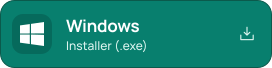
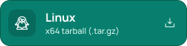
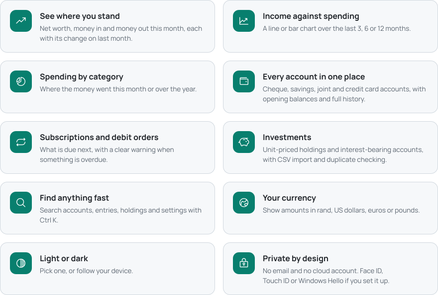

<div align="center">

<picture>
  <source media="(prefers-color-scheme: dark)" srcset="assets/logo-dark.svg">
  
</picture>

<h3>Every cent, accounted for.</h3>

A private personal finance tracker for Windows, Linux and iPhone.<br>
Your ledger lives on your device. No email, no cloud account.

<a href="https://github.com/meetocode/ledgerly/releases/latest"></a>

<a href="LICENSE"></a>

</div>

## Download

[Release notes](https://github.com/meetocode/ledgerly/releases/latest) · [All releases](https://github.com/meetocode/ledgerly/releases)

<p>
  <a href="https://github.com/meetocode/ledgerly/releases/latest/download/Ledgerly-Setup.exe"></a>
  <a href="https://github.com/meetocode/ledgerly/releases/latest/download/Ledgerly-linux-x64.tar.gz"></a>
  <a href="https://github.com/meetocode/ledgerly/releases/latest/download/Ledgerly-unsigned.ipa"></a>
</p>

| | Platform | File | What it is |
|:-:|---|---|---|
|  | **Windows** | [`Ledgerly-Setup.exe`](https://github.com/meetocode/ledgerly/releases/latest/download/Ledgerly-Setup.exe) | Installer. No administrator rights needed. |
|  | **Windows** | [`Ledgerly-windows-x64-portable.zip`](https://github.com/meetocode/ledgerly/releases/latest/download/Ledgerly-windows-x64-portable.zip) | Portable. Unzip and run, nothing to install. |
|  | **Linux** | [`Ledgerly-linux-x64.tar.gz`](https://github.com/meetocode/ledgerly/releases/latest/download/Ledgerly-linux-x64.tar.gz) | 64-bit build for Debian, Ubuntu and similar. |
|  | **iPhone** | [`Ledgerly-unsigned.ipa`](https://github.com/meetocode/ledgerly/releases/latest/download/Ledgerly-unsigned.ipa) | Unsigned app. Install it with Sideloadly. |

## What's coming

Ledgerly 0.0.x is an early preview. These are on the way:

<picture>
  <source media="(prefers-color-scheme: dark)" srcset="assets/features-dark.svg">
  
</picture>

## Install

### Windows

1. Download and run `Ledgerly-Setup.exe`. No administrator rights are needed.
2. Ledgerly isn't code-signed yet, so Windows may show "Windows protected your PC". Click **More info**, then **Run anyway**.
3. Installing a newer version over an older one keeps your data.
4. From 0.0.2 on, the installed app keeps itself up to date: it checks once a day (you can turn this off in Settings › About), downloads the update, checks it is genuine, and installs it when you restart or close Ledgerly. The portable zip, Linux and iPhone builds tell you when an update is out and link here.

> [!WARNING]
> **Uninstalling deletes your data.** Uninstalling Ledgerly (Settings › Apps) permanently deletes all Ledgerly data on the computer, including every user's ledger, after asking you to confirm. Your Recovery Key can't bring it back.

The portable zip needs no install: unzip it and run `ledgerly.exe`. It uses the same data folder, `%APPDATA%\Ledgerly\Ledgerly`.

### Linux

```bash
sudo apt install libgtk-3-0 libssl3      # Debian / Ubuntu
mkdir ledgerly && tar -xzf Ledgerly-linux-x64.tar.gz -C ledgerly
./ledgerly/ledgerly
```

Your data is in `~/.local/share/app.ledgerly.ledgerly/`. Delete that folder to remove it.

### iPhone

The iPhone build isn't on the App Store. You install it from a Windows or Mac computer with [Sideloadly](https://sideloadly.io/), which signs it with your own Apple ID.

1. Install Sideloadly and connect your iPhone with a USB cable.
2. Drag `Ledgerly-unsigned.ipa` into Sideloadly. Sign in with your Apple ID (an [app-specific password](https://support.apple.com/102654) is recommended) and click **Start**. If it complains about the bundle ID, enable Sideloadly's option to change it.
3. On the iPhone: **Settings › General › VPN & Device Management**, trust your Apple ID's developer profile. Then turn on **Settings › Privacy & Security › Developer Mode** and restart when asked.
4. With a free Apple ID the app stops opening after 7 days. Install it again the same way.

> [!IMPORTANT]
> Installing over the existing app keeps your data, but deleting the app deletes its data.

## Licence

Free to use. See [LICENSE](LICENSE). The source code isn't public.
